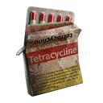
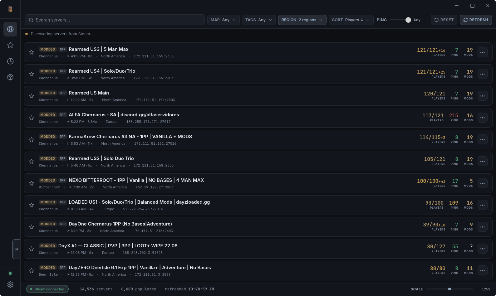
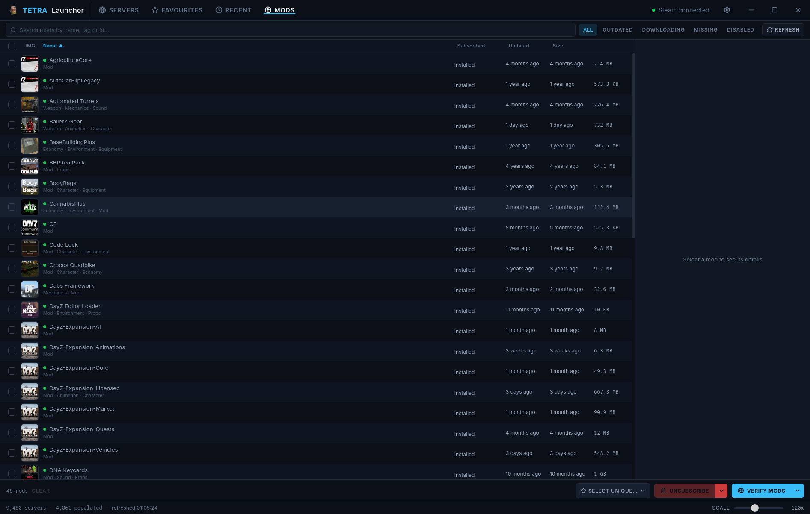

<div align="center">



# TETRA LAUNCHER

**Find the server. Trust the mod list.**

A DayZ server browser and Workshop mod manager for Windows and Linux —
free to use, source-available, and built around one idea: check the mods
*before* you connect, not after.

[**tetralauncher.com**](https://tetralauncher.com) · [Download](https://tetralauncher.com/download.html) · [Changelog](CHANGELOG.md)

[](https://github.com/HellboundGlory/dayz-launcher/actions/workflows/check.yml)
[](https://github.com/HellboundGlory/dayz-launcher/releases/latest)
[](LICENSE)

</div>

<br/>



## What it does

**`[BROWSE]` Server browser** — Filter by map, tags, region and ping. Hide
empty, full, locked or offline servers. Favourites and Recently Played, kept
on your machine — your server list is nobody's business but yours.

**`[VERIFY]` Verify & Join** — Re-reads a server's mod list live and checks
the Workshop directly before launching — not Steam's cached "needs update"
bit, which can be stale by the time you click Join.

**`[MANAGE]` Mod manager** — See every subscribed mod, which of your
favourite servers need it, and reinstall a corrupted copy in one click —
without hunting through Steam's Workshop pages.

**`[THEME]` Themes** — Recolour the launcher from Settings, pick the built-in
Tactical layout, or build a theme that rearranges the whole window. See the
[theme guide](https://tetralauncher.com/docs/themes/).

**`[SIGNAL]` Discord presence** — Shows the server you're playing on in
Discord, with a one-click way for friends to join you straight from your
profile.



## Get it

**[tetralauncher.com/download.html](https://tetralauncher.com/download.html)** always has the current release for every platform:

- **Windows** — installer or a portable `.zip`
- **Linux** — AppImage, `.deb` or `.rpm`

The launcher checks for updates itself once installed (portable copies notify with a link instead of auto-installing).

## Building from source

Requires a stable Rust toolchain and Node.js.

```bash
npm ci
npx tauri build --debug
```

**Use `npx tauri build --debug`, not plain `cargo build`.** Both write to the
same path, but a plain `cargo build` resolves the dev server URL instead of
the bundled frontend, so the result opens on "localhost refused to connect."

To run it with hot reload while you work:

```bash
npx tauri dev
```

To check the code without producing a binary:

```bash
cargo fmt --all --check
cargo clippy --locked --workspace --all-targets -- -D warnings
cargo test --locked --workspace
npm run build
npm test
npm run lint
```

CI runs these, plus the UI harness smoke check (`npm run harness:smoke`), on every
push that touches more than `docs/` — see [`.github/workflows/check.yml`](.github/workflows/check.yml).

## Repository layout

- `src/` — the React + Vite frontend.
- `src/components/` — the shared dialogs, modals and window handles, plus the `themes-page/` folder.
- `src/hooks/` — startup, refresh-loop, server-data, mod-list and backend-event hooks.
- `src/stores/` — the launcher's client-side state.
- `src/lib/` — Tauri IPC bindings, the updater and small helpers.
- `src/types/` — shared TypeScript types for servers, filters and themes.
- `src/theme/` — the theme engine: registry, tokens, CSS loading and settings schemas.
- `src/theme/elements/` — the themed elements the layout renderer draws.
- `src/theme/renderer/` — turns a theme's layout into React nodes.
- `src/theme/neutral/` — the neutral theme's own markup and styles.
- `src/theme/lists/` — the list hosts, rows and headers, with keyboard navigation.
- `src/theme/interaction/` — tabs, accordions, popups and modals.
- `src/theme/fallback/` — the visibility check that rejects a layout it can't render.
- `src/theme/dev/` — Dev Mode's store and contrast checker.
- `src-tauri/` — the Tauri shell: IPC commands, the theme validator and package handling, and the bundled builtin themes under `resources/`.
- `crates/tetra-core/` — A2S wire-format parsing and server classification.
- `crates/tetra-net/` — async UDP transport for A2S queries.
- `crates/tetra-registry/` — the SQLite registry, the only crate that owns SQL.
- `crates/tetra-steam/` — Steamworks access, confined to one thread.
- `crates/tetra-launch/` — the pre-launch mod gate, the `dzsa://` handler and the DayZ process spawn.
- `crates/tetra-index/` — the wire format shared with `tetra-indexer` and the client that fetches the server index.
- `crates/tetra-discord/` — Discord Rich Presence.
- `crates/tetra-indexer/` — the separate server-index backend, deployed from `deploy/`.
- `tools/harness/` — headless screenshots and the smoke, visual and perf checks (see its README).
- `tools/docs/` — the theme docs generator.
- `docs/` — the website and the theme docs (`docs/docs/themes/`), deployed by GitHub Pages.
- `deploy/` — the indexer container.
- `index.html`, `splash.html`, `theme-guard.html` — the three window entries.
- `.github/workflows/` — CI: the check suite and its shared Rust check, the indexer image, Pages and releases.

It compiles and ships on both Windows and Linux — Windows-only code (Steam
registry discovery, the `dzsa://` protocol handler on that platform) is
`cfg(windows)`-gated, with a Linux equivalent where one exists.

## Contributing

Issues and pull requests are welcome.

## License

[PolyForm Noncommercial 1.0.0](LICENSE) — you're free to use, modify, and
contribute to this project for any noncommercial purpose. Selling it,
hosting a paid service built on it, or other commercial use isn't permitted
without the licensor's permission.

Not affiliated with Bohemia Interactive.
